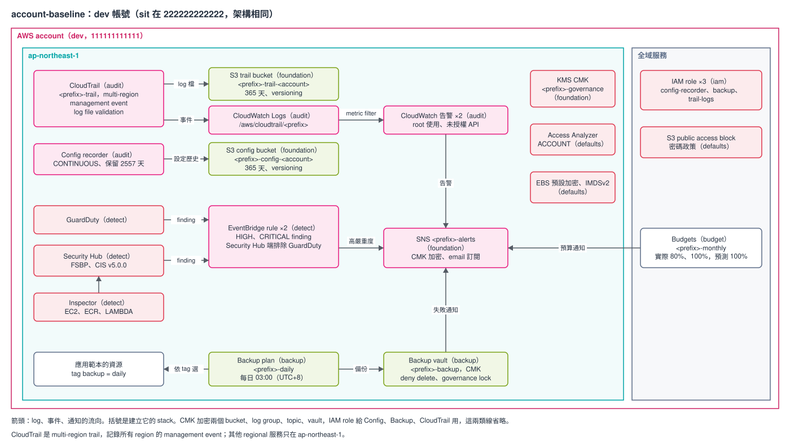

# 範本 account-baseline：帳號層治理

每個 AWS 帳號複製一份、apply 一次，在應用範本之前建好。內容是帳號層的稽核、偵測、備份與成本告警：CloudTrail、Config、GuardDuty、Security Hub（FSBP 與 CIS）、Inspector、IAM Access Analyzer、帳號安全預設、AWS Backup、Budgets。它跟應用範本（example2–example6、project-infra）分開放，所以同一個帳號放好幾個專案時，trail、recorder、detector 只會建一份。

應用範本不讀這份範本的 SSM，兩邊沒有 apply 順序的硬性相依。唯一的約定是 Backup：應用範本的資源加了 `backup = "daily"` tag，Backup 才會每天備份它，見 [REFERENCE〈Backup 的 tag 約定〉](./REFERENCE.md#backup-的-tag-約定)。



圖是 dev 帳號，sit 架構相同。要修改就用 draw.io 打開 `architecture.drawio.svg`，存檔後原圖會一起更新。

規則跟其他範本相同：7 個 Terraform stack，stack 之間只透過 SSM Parameter Store 傳值，stack 只呼叫 registry 的 module。環境只有 `dev`（`111111111111`）、`sit`（`222222222222`），一個環境一個帳號。範本示範單一帳號；AWS Organizations 的帳號分工見 [REFERENCE〈Organizations 模式〉](./REFERENCE.md#organizations-模式)。目前只做過離線驗證，還沒在真實帳號 apply 過。

## stack 與 apply 順序

apply 由上往下，destroy 反過來。順序只定義在 `stacks.sh` 的 `ORDER`：

```
foundation defaults iam audit detect backup budget
```

| 順序 | stack | 建什麼 |
|---|---|---|
| 1 | `foundation` | 治理用 CMK、CloudTrail 與 Config 的 log bucket（各一個，保留 365 天、versioning）、資安告警 SNS topic |
| 2 | `defaults` | S3 account public access block、EBS 預設加密、IMDSv2 預設、IAM 密碼政策、Access Analyzer（`ACCOUNT`） |
| 3 | `iam` | Config recorder、Backup、CloudTrail 寫 CloudWatch Logs 用的三個 role |
| 4 | `audit` | multi-region trail（送 bucket 與 CloudWatch Logs）、兩個 CloudTrail 告警、Config recorder |
| 5 | `detect` | GuardDuty、Security Hub（FSBP、CIS v5.0.0）、Inspector，高嚴重度 finding 經 EventBridge 送告警 topic |
| 6 | `backup` | Backup vault（CMK、禁止刪 recovery point、governance lock）與每日備份 plan |
| 7 | `budget` | 月成本預算，實際 80%、100% 與預測 100% 時通知 |

每個 stack 讀哪些 key、發布哪些 key，見 REFERENCE〈stack 的內容〉與〈SSM 合約〉。

## 怎麼部署

`stacks.sh` 把 backend、tfvars、`TF_DATA_DIR` 綁在一起，AWS 身分自己帶：

```bash
cd infra/terraform
aws-vault exec <profile> -- ./stacks.sh dev all plan --dry-run   # 只印出會執行的指令
aws-vault exec <profile> -- ./stacks.sh dev audit plan           # 單一 stack
aws-vault exec <profile> -- ./stacks.sh dev all apply            # 依 ORDER，任何一個失敗就停
```

### 第一次 apply

這段是給複製範本、在自己帳號部署的人。這個 repo 不 apply。

1. 先確認帳號裡已經有哪些服務。Config recorder 與 GuardDuty detector 一個 region 只能有一個，已經有的話 `audit`、`detect` 會 apply 失敗；Security Hub 已經啟用也一樣。CloudTrail 可以有多條，但第二條 trail 的 management event 要另外計費。查法：

   ```bash
   aws cloudtrail describe-trails
   aws configservice describe-configuration-recorders
   aws guardduty list-detectors
   aws securityhub describe-hub
   ```

   查到的話，先照 [REFERENCE〈帳號已經有 trail、recorder 或 detector〉](./REFERENCE.md#帳號已經有-trailrecorder-或-detector) import 或在 console 移除。
2. `./stacks.sh dev all apply`。
3. 告警 topic 的每位 email 收件人會收到 SNS 的確認信，要點確認才收得到告警。預算通知的 email 由 Budgets 直接寄，不用確認。
4. 在應用範本要備份的資源加 `backup = "daily"` tag。

## 複製出去之後要改什麼

1. module 的 `source`（HCP organization 或 git 來源，見 [`docs/guides/consuming-modules.md`](../../../docs/guides/consuming-modules.md)）。
2. 7 個 stack 的 `common.tf` 的 `accounts_by_env`（`111111111111`、`222222222222`），同步改、保持一字不差。
3. 每份 `envs/*.tfbackend` 的 `bucket`、`kms_key_id`，`key` 的 `baseline-` 前綴換成自己的 `project`。
4. 每份 tfvars 的 `project`、`expected_account_id`。
5. `foundation` 的 `alert_emails`、`budget` 的 `monthly_budget_usd`（dev 100、sit 300，都是佔位）與 `budget_emails`。
6. 保留期：`audit` 的 `trail_log_retention_days`、`backup` 的 `vault_min_retention_days` 與 `backup_delete_after_days`。log bucket 的 365 天與 Config 的 2557 天寫在程式碼裡（`foundation/buckets.tf`、`audit/config.tf`）。

完整清單見 REFERENCE〈複製出去之後要改什麼〉。

## 已知限制

細節見 [REFERENCE〈已知限制的細節〉](./REFERENCE.md#已知限制的細節)，第一次 apply 時要逐項確認。

- 只有 CloudTrail 涵蓋所有 region；GuardDuty、Security Hub、Config、Inspector、Access Analyzer 只在 `ap-northeast-1`，FSBP 與 CIS 會對沒啟用的 region 出 finding。其他 region 的開法見 REFERENCE〈啟用其他 region〉。
- log bucket 保留 365 天、開 versioning、不 force destroy，destroy 時刪不掉是預期的。停用 GuardDuty 與 Security Hub 會刪掉既有 finding。
- vault lock 是 governance 模式，有權限的人仍可解除；要真正刪不掉就改 compliance，但改了永遠解不開。
- Budgets 送 SNS 只靠 `aws:SourceAccount` 條件、CloudTrail 與 Config 的 bucket 與 key policy 條件、EventBridge 的 event pattern、CIS v5.0.0 的 ARN，都沒有在真實帳號確認。
- Organizations 模式沒有範本示範，只有 module 測試與 REFERENCE 的說明；Backup 的委派不在範圍內。

## 驗證

```bash
scripts/validate.sh templates/account-baseline/infra/terraform
```

全部離線，不需要 AWS 憑證，但需要 HCP registry token。其餘內容（SSM 合約、Organizations 模式、import、destroy、成本）都在 [REFERENCE.md](./REFERENCE.md)。
