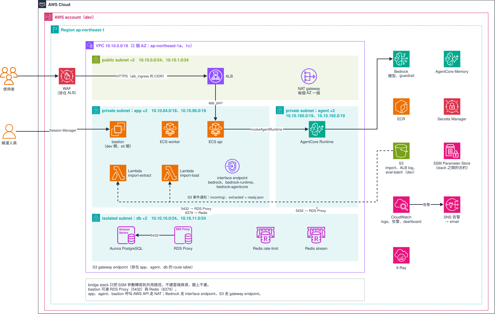

# 範本 example2：13 個 stack 的專案 infra

適合跑在 ECS Fargate、帶 Aurora PostgreSQL、Redis、ALB 與 AgentCore 的專案，而且希望資料庫、IAM、ALB、AgentCore、ECS、bastion、告警各自獨立 apply（拆法跟 `templates/project-infra` 不同）。13 個 stack 之間只透過 SSM Parameter Store 傳值，每個 stack 都只呼叫 registry 的 module，不自己宣告 AWS resource。

> 狀態：13 個 stack 離線驗證通過（`scripts/validate.sh`），還沒在真實帳號 apply 過；「已知限制」裡的推論都要在第一次 apply 時確認。設計見 [`docs/design/v2/design-docs.md`](../../../docs/design/v2/design-docs.md) 第 5 章。



圖是 `dev` 的樣子。`sit` 的元件相同，差別是 bastion 關閉、沒有 eval-batch bucket，tfvars 另外示範了一條 VPC peering。用 draw.io 打開 `architecture.drawio.svg` 就能編輯。

## apply 順序

apply 照下表由上往下，destroy 反過來；順序只定義在 `stacks.sh` 的 `ORDER`。環境只有 `dev` 與 `sit`。

| 順序 | stack | 建什麼 |
|---|---|---|
| 1 | `containerimage` | ECR repository |
| 2 | `foundation` | 告警 SNS topic、簽章 key 的 secret 容器 |
| 3 | `dns` | 這個環境的子網域 hosted zone（`<env>.example.com`） |
| 4 | `certificate` | 兩張 ACM 憑證：ALB 用的（`api` 與 `origin-api`）、CloudFront 用的（us-east-1） |
| 5 | `network` | VPC、四層 subnet、NAT、endpoint、security group、可選的 VPC peering |
| 6 | `database` | Aurora PostgreSQL、RDS Proxy、兩組 Redis |
| 7 | `iam` | ECS、Lambda、AgentCore 的 role |
| 8 | `bridge` | 不建資源，只把樹 A 的 SSM key 轉寫到樹 B |
| 9 | `loadbalancer` | ALB（HTTPS:443，HTTP:80 只轉到 443）、WAF、access log |
| 10 | `agent` | Bedrock guardrail、AgentCore Runtime 與 Memory |
| 11 | `application` | ECS cluster、`api` 與 `worker` 服務、autoscaling |
| 12 | `operation` | bastion（可關）、兩個 import Lambda、bucket |
| 13 | `postdeploy` | 服務告警、dashboard、trace；四個功能各有開關，預設全關 |

9–13 只讀樹 B（`/<project>-shared/<env>/infra/<key>`），外加其他後段 stack 的樹 A key，不直接讀前段 stack。樹 B 預設由 `bridge` 寫；要改由外部發布，見 [REFERENCE](./REFERENCE.md)〈樹 B 的 key 合約〉。

## 部署

```bash
cd infra/terraform
./stacks.sh <env> <stack|all> <init|validate|plan|apply|destroy|output> [--yes] [--dry-run] [-- <terraform 參數>...]
```

```bash
cd infra/terraform
./stacks.sh dev all plan --dry-run        # 只看會跑哪些指令
./stacks.sh dev network plan              # 單一 stack
./stacks.sh dev all apply --yes           # 依序 apply，不再詢問
./stacks.sh dev all destroy               # 反向 destroy，先看 REFERENCE〈destroy 之前〉
```

- 第一次部署要先單獨 apply `dns`，在上層網域做完 NS 委派才跑 `all`，步驟見下面〈第一次 apply〉。
- `plan`、`apply` 前要先 `export TF_VAR_origin_verify_header_value=<至少 16 字元>`，少了它 plan 直接失敗。
- `stacks.sh` 綁好 backend、tfvars 與 `TF_DATA_DIR`，AWS 身分要自己換（例如 `aws-vault exec <profile> --`）。
- destroy 之前，Aurora、ALB 的 deletion protection 要先關，ECR 與 S3 要先清空，secret 的值要先備份，細節見 [REFERENCE](./REFERENCE.md)〈destroy 之前〉。

### 第一次 apply

`certificate` 用 DNS 驗證憑證，上層網域沒把子網域委派過來，憑證就簽不下來。所以第一次要分兩段：

1. `./stacks.sh dev dns apply`，記下輸出的 4 個 name server（之後可以用 `./stacks.sh dev dns output` 再看）。
2. 在上層網域 `example.com` 的 zone 加一筆 `dev.example.com` 的 NS record，值是上一步的 4 個 name server。用 `dig NS dev.example.com +short` 確認查得到這 4 個。
3. `./stacks.sh dev all apply`。`certificate` 會等到兩張憑證都簽發才結束；委派沒做好的話，等滿 45 分鐘會 timeout 失敗。

之後的 apply 不用再等：憑證已經簽發，到期前 ACM 會自動續約。完整說明見 [REFERENCE](./REFERENCE.md)〈第一次 apply〉。

離線驗證（不需要 AWS 憑證，需要 HCP registry token）：

```bash
scripts/validate.sh templates/example2/infra/terraform
```

## 複製出去之後要改什麼

範本裡的值都是佔位，照下面順序改，每一步的細節見 [REFERENCE](./REFERENCE.md)〈改值的細節〉：

1. module 的 `source`：用自己的 HCP organization 就換掉 `app.terraform.io/libterty/<module>/aws` 的前綴，拿不到 HCP token 就改成 `git::...?ref=<module>-v<semver>`（見 `docs/guides/consuming-modules.md`）。
2. `common.tf` 的 `accounts_by_env`：填真實帳號，13 個 stack 一起改，保持一字不差。
3. `envs/*.tfbackend`：`bucket` 換成真實的 state bucket，`key` 的 `example-` 前綴換成自己的 `project`。
4. `envs/*.tfvars` 的佔位值：`project`、`expected_account_id`、告警信箱、CIDR、網域（`dns` 的 `zone_name`）、映像 tag、資料庫規格、模型。
5. origin verify 的值：不放 tfvars，用上面的 `export` 給。
6. `agent/guardrails.tf`：denied topic、詞彙、拒絕文案都只是示意，換成自己產品的政策。
7. 命名規則：`iam` 用命名規則組 ARN，改 bucket、log group、AgentCore、metric namespace 的名稱時，`iam` 要一起改。
8. 跨 stack 要一致的值：`bastion_enabled`、`guardrail_cross_region_profile_id`、`app_port`。

## 已知限制

下面都是 mock 驗不到的推論，第一次 apply 時要逐項確認，細節見 [REFERENCE](./REFERENCE.md)〈已知限制的細節〉：

- IAM 與 policy 的形狀：RDS Proxy、Enhanced Monitoring、AgentCore Runtime、bastion 的權限是否足夠。
- DNS 與憑證：上層網域的 NS 委派是人工步驟，委派錯了 `certificate` 會等到 timeout。
- ALB 與 WAF：access log 的 vended delivery、WAF logging 需要的 apply 身分權限。
- AgentCore 與 Bedrock：Runtime 的 log delivery、guardrail 加 cross-region profile 的實際行為。
- 網路：沒有 NAT 時缺 ECR、CloudWatch Logs、Secrets Manager 的 interface endpoint。
- S3 通知的 prefix 與 suffix 要到 apply 時才驗。
- autoscaling 的 metric math 是否被 provider 接受。
- 跟應用程式的約定（pg_cron 的 log 字串、`ready.json` 觸發）沒有東西檢查。

SSM 合約、腳本行為、改值與 destroy 的完整說明見 [REFERENCE.md](./REFERENCE.md)。
