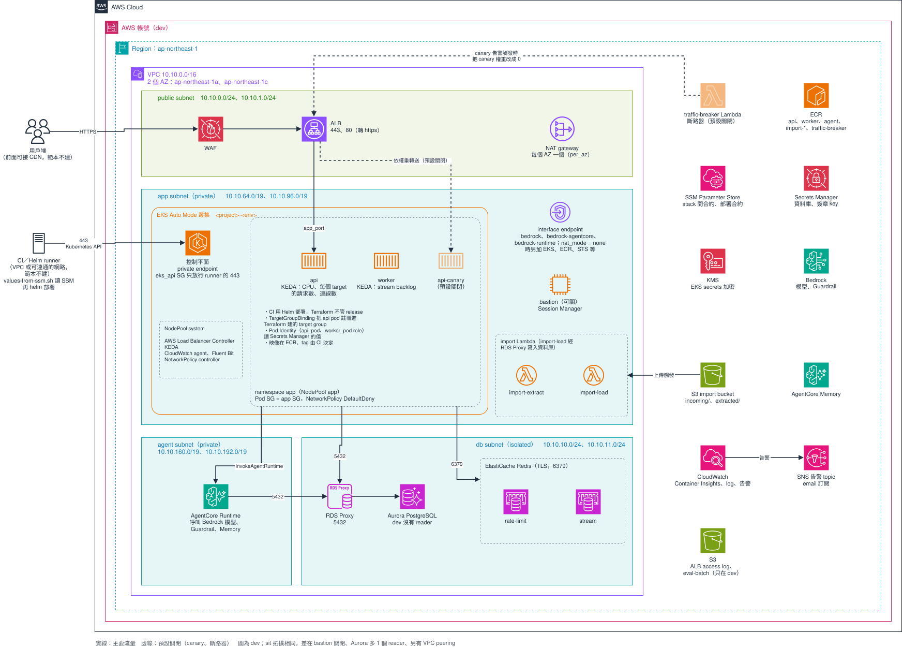

# 範本 example3：example2 的 EKS 版

> 狀態：13 個 stack、範例 chart 與部署腳本都已完成，離線驗證通過（見 REFERENCE〈驗證〉）。還沒有在真實帳號或叢集 apply 過，第一次 apply 時要逐項確認 REFERENCE〈雲端整合待驗證〉與下面的〈已知限制〉。設計見 [`docs/design/v4/design-docs.md`](../../../docs/design/v4/design-docs.md)，實作紀錄見 [`implement-process.md`](../../../docs/design/v4/implement-process.md)。

應用跑在 EKS、用 Helm 部署時用這份範本。拆法跟 [`templates/example2`](../../example2/infra/README.md) 相同（13 個 Terraform stack，stack 之間只透過 SSM Parameter Store 傳值），只有 api 與 worker 改跑在 EKS Auto Mode，由 CI 用 [`deploy/values-from-ssm.sh`](../deploy/values-from-ssm.sh) 讀 SSM 後以 Helm 部署 [`deploy/charts/app`](../deploy/charts/app)，Terraform 不部署它們。



圖是 `dev` 的架構。`sit` 拓撲相同，差在 bastion 關閉、Aurora 多一個 reader、另有 VPC peering。`architecture.drawio.svg` 可以直接用 draw.io 打開編輯。

## apply 順序

apply 由上往下，destroy 反過來。順序定義在 `stacks.sh` 的 `ORDER`；每個 stack 讀什麼、發布什麼見 REFERENCE。

| 順序 | stack | 建什麼 |
|---|---|---|
| 1 | `containerimage` | ECR repository（6 個映像） |
| 2 | `foundation` | 告警 SNS topic、簽章 key 的 secret 容器 |
| 3 | `network` | VPC 四層 subnet、NAT、endpoint、security group、可選的 VPC peering |
| 4 | `database` | Aurora PostgreSQL 與 RDS Proxy、兩組 Redis |
| 5 | `iam` | Lambda、AgentCore、EKS 用的 role |
| 6 | `bridge` | 把樹 A 的 key 轉寫成樹 B |
| 7 | `eks-cluster` | EKS 叢集（只有 private endpoint）、KMS key、access entry、Pod Identity |
| 8 | `eks-addons` | NodeClass／NodePool、NetworkPolicy、LB Controller、KEDA、CloudWatch 採集 |
| 9 | `loadbalancer` | ALB、WAF；可選的 canary 與斷路器（預設關閉） |
| 10 | `agent` | Bedrock guardrail、AgentCore Runtime 與 Memory |
| 11 | `application` | 不建資源，只發布部署合約 |
| 12 | `operation` | bastion、import Lambda 與 bucket |
| 13 | `postdeploy` | 工作負載、stream、log 告警與 trace |

`application` 之後、`postdeploy` 之前，CI 要先部署一次 api 與 worker（見〈部署〉）。

## 執行環境

叢集只有 private endpoint，`eks-addons` 的 apply 與 CI 的 Helm 部署要在 VPC 或可連通的網路裡跑（self-hosted runner、VPC 內的 CodeBuild、VPN、bastion），範本不建 runner。DNS、路由、SG、權限的條件見 REFERENCE〈執行環境的條件〉。

## 部署

Terraform 部分用 `stacks.sh`：

```bash
cd infra/terraform
./stacks.sh dev all plan --dry-run        # 只看會跑哪些指令
./stacks.sh dev network plan              # 單一 stack
./stacks.sh dev all apply --yes           # 依序 apply，不再詢問
./stacks.sh dev all destroy               # 反向 destroy，先看 REFERENCE〈destroy 之前〉
```

destroy 前要先處理的資源見 REFERENCE〈destroy 之前〉。

api 與 worker 由 CI 部署，執行身分是 `eks-cluster` 的 `ci_deploy_principal_arn`：

```bash
cluster="example-dev"
aws eks update-kubeconfig --name "$cluster" --region ap-northeast-1

for c in api worker; do
  templates/example3/deploy/values-from-ssm.sh --project example --env dev --component "$c" --image-tag 1.2.3 >"$c.json"
  helm upgrade --install "$c" templates/example3/deploy/charts/app -n "$(jq -r .namespace "$c.json")" -f "$c.json" --atomic
done
```

CI 要的權限與 chart 的規則見 REFERENCE〈部署的細節〉，canary 的流程見 REFERENCE〈canary〉。

## 複製出去之後要改什麼

範本裡的值都是佔位，照順序改（每一項的細節見 REFERENCE〈複製出去之後要改什麼：細節〉）：

1. module 的 `source`（HCP private registry 的 organization）。
2. `common.tf` 的帳號表，13 個 stack 保持一字不差。
3. 每份 `envs/*.tfbackend` 的 state bucket 與 `key` 前綴。
4. 每份 `envs/*.tfvars` 的佔位值。
5. origin verify 的值：只能用 `TF_VAR_origin_verify_header_value` 給，不放 tfvars。
6. `agent/guardrails.tf` 的 guardrail 內容。
7. `deploy/charts/app` 的 health check、`resources`、`dataPorts`。
8. 命名規則：`iam` 用名稱組 ARN，改名時兩邊一起改。
9. `SHARED_CONFIG_KEYS` 與 `app_port` 的一致性。

## 已知限制

下面都是 mock 驗不到的推論，第一次 apply 時要逐項確認，逐項內容見 REFERENCE〈已知限制：細節〉：

- EKS 的網路：node 與 pod 共用 app subnet、SG 規則、NetworkPolicy `DefaultDeny`、沒有 NAT 時的 interface endpoint。
- Auto Mode、LB Controller 與 CI 的權限、Pod Identity、helm provider 的實際行為。
- KEDA 擴縮與 Container Insights 的 log 格式、告警。
- 沿用 example2 的 IAM、ALB 與 WAF、AgentCore 與 Bedrock、跟應用程式的約定。
- canary 告警一建立就會響；應用程式必須在 `app_port` 回應 `/health`。

參考資料（各 stack 的讀寫、SSM 合約、canary、IP 預算、destroy 之前、驗證）見 [REFERENCE.md](./REFERENCE.md)。
