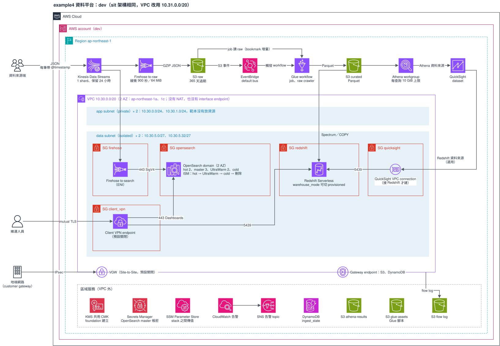

# 範本 example4：資料平台

適合要把事件資料同時送進資料湖（S3、Glue、Athena、Redshift、QuickSight）和搜尋（OpenSearch 冷熱分層）的專案。資料寫進 Kinesis 後分兩路：一路經 Firehose 進 S3，由 Glue 轉成 Parquet 給 Athena、Redshift、QuickSight 讀；另一路經 Firehose 進 VPC 內的 OpenSearch。

成本（估計）：dev、sit 各約 1,150–1,300 美元／月起，大部分是 OpenSearch；明細與 VPN 加價見 [REFERENCE〈成本（估計）〉](./REFERENCE.md#成本估計)。不用的環境請照 REFERENCE〈destroy〉拆掉。



圖是 dev 環境，sit 架構相同（VPC 是 `10.31.0.0/20`）。要修改就用 draw.io 打開 `architecture.drawio.svg`，存檔後原圖會一起更新。

規則跟其他範本相同：12 個 Terraform stack，stack 之間只透過 SSM Parameter Store 傳值，stack 只呼叫 registry 的 module。例外有兩個（[`project-infra-standard.md`](../../../docs/guides/project-infra-standard.md)〈例外清單〉）：`search-config` 用 ephemeral 讀 master 帳密、`warehouse` 的 `terraform_data` 防呆。環境只有 `dev`、`sit`。目前只做過離線驗證，還沒在真實帳號 apply 過。

## stack 與 apply 順序

apply 由上往下，destroy 反過來。順序只定義在 `stacks.sh` 的 `ORDER`：

```
foundation network vpn storage iam-base search search-config analytics iam-app pipeline warehouse bi
```

| 順序 | stack | 建什麼 |
|---|---|---|
| 1 | `foundation` | 共用 CMK、告警 SNS、flow log bucket、OpenSearch master secret 容器、Glue Data Catalog 加密 |
| 2 | `network` | VPC（`app`、`data` 兩層，2 AZ，沒有 NAT）、gateway endpoint、6 個 SG |
| 3 | `vpn` | Client VPN、Site-to-Site VPN，預設零資源 |
| 4 | `storage` | 四個資料湖 bucket、Glue database、Kinesis、DynamoDB |
| 5 | `iam-base` | 之後的 stack 一建立就要用的 6 個 role |
| 6 | `search` | OpenSearch domain（hot、UltraWarm、cold） |
| 7 | `search-config` | ISM、FGAC role 與 mapping、index template；要從連得到 domain 的網路執行 |
| 8 | `analytics` | Athena workgroup、預存查詢 |
| 9 | `iam-app` | Firehose role 的 policy、QuickSight Athena role |
| 10 | `pipeline` | Firehose 兩條、Glue ETL 與 EventBridge 觸發 |
| 11 | `warehouse` | Redshift（Serverless 或 provisioned）與防呆 |
| 12 | `bi` | QuickSight 資料來源與 dataset |

每個 stack 讀哪些 key、發布哪些 key，見 REFERENCE〈stack 的內容與依賴〉與〈SSM 合約〉。

## 前置作業

依序做，括號是最晚要在哪一步之前完成。做法見 [REFERENCE〈前置作業的細節〉](./REFERENCE.md#前置作業的細節)，編號相同。

1. state bucket 的強化（第一次 `init` 之前）：專用 CMK 填進 24 份 `.tfbackend` 的 `kms_key_id`、bucket policy、舊版本 30 天過期、CloudTrail data event。
2. 寫入 OpenSearch master secret 的值（`foundation` apply 之後、`search` plan 之前）。
3. Glue Data Catalog 加密每個帳號、每個 region 只能一處設定（`foundation` apply 之前）；**同帳號的第二個專案要設 `null`**。
4. QuickSight 訂閱與 secret 授權（`bi` apply 之前）。
5. Redshift 唯讀 DB user 與 secret（`warehouse` apply 之後、`bi` 帶 `redshift_reader_secret_arn` apply 之前）；不接 Redshift 可略過。
6. Lake Formation 維持 IAM 模式（`storage` apply 之前）。
7. 執行 apply 的身分要有特權操作：`iam:CreateServiceLinkedRole`、`iam:PassRole`、`kms:CreateGrant`、`secretsmanager:GetSecretValue`、`glue:PutDataCatalogEncryptionSettings`、`events:PutRule`、`events:PutTargets`。

## 怎麼部署

`stacks.sh` 把 backend、tfvars、`TF_DATA_DIR` 綁在一起，AWS 身分自己帶：

```bash
cd infra/terraform
aws-vault exec <profile> -- ./stacks.sh dev all plan --dry-run   # 只印出會執行的指令
aws-vault exec <profile> -- ./stacks.sh dev network plan         # 單一 stack
aws-vault exec <profile> -- ./stacks.sh dev all apply            # 依 ORDER，任何一個失敗就停
./stacks.sh dev all destroy --dry-run                            # 看 destroy 的順序
./stacks.sh dev vpn plan -- -var-file=envs/examples/vpn.tfvars   # 用範例 tfvars 看開 VPN 的 plan
```

`all` 包含 `search-config`，所以整串要在連得到 domain 的網路裡跑（REFERENCE〈`search-config` 的執行環境〉）。不然就分段：先 `foundation` 到 `search`，換到能連 domain 的環境跑 `search-config`，再跑 `analytics` 到 `bi`。

複製出去之後要改的地方（module 來源、帳號表、state、tfvars 佔位值、Glue job）見 REFERENCE〈複製出去之後要改什麼〉。

## 已知限制

細節見 [REFERENCE〈已知限制的細節〉](./REFERENCE.md#已知限制的細節)，第一次 apply 時要逐項確認。

- OpenSearch master 密碼會進 `search` 的 state，這是登記過的安全例外（REFERENCE〈安全例外〉）。
- VPC 沒有 NAT 與 interface endpoint，`search-config` 要從 Client VPN 跑，或自己補對外的路。
- IAM 動作清單、告警門檻、範例 Glue job 都沒有在真實帳號驗證過。
- Redshift 沒有 S3 egress，EVR 預設關閉；開 EVR 要補 egress，Serverless 還要 3 個 AZ。
- `prevent_destroy` 與 `search-config` 的 ephemeral 讀取，`terraform test` 驗不到。
- 改 `warehouse_mode` 會被防呆擋下，要照 REFERENCE〈`warehouse_mode` 切換〉的步驟做；serverless → provisioned 不會留 snapshot。

## 驗證

```bash
scripts/validate.sh templates/example4
```

全部離線，不需要 AWS 憑證，但需要 HCP registry token。驗證結果與雲端整合待驗證的清單見 REFERENCE〈驗證〉。

其餘內容（SSM 合約、安全例外、EventBridge 觸發、runbook、驗證表）都在 [REFERENCE.md](./REFERENCE.md)。
