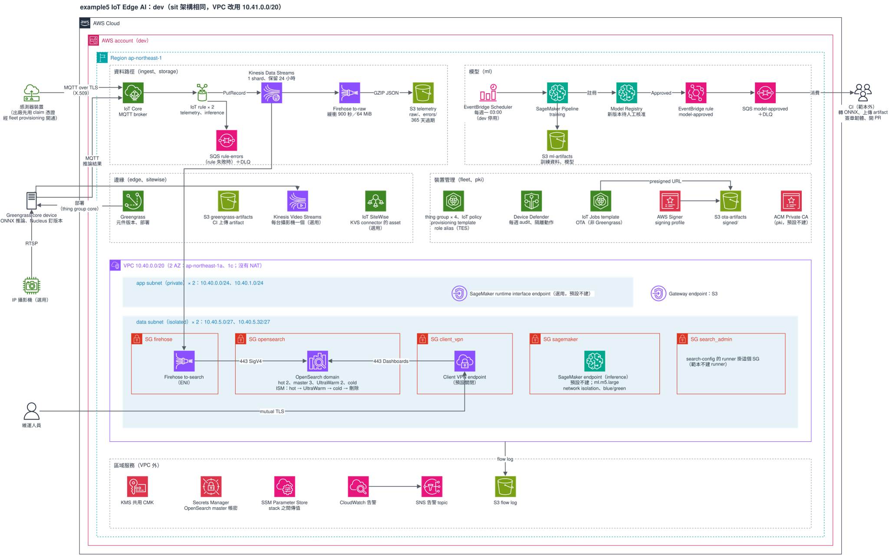

# 範本 example5：IoT Edge AI

適合有一批感測器或邊緣裝置、要在雲端收資料、在邊緣跑模型的專案。裝置用 MQTT 連 IoT Core，資料經 Kinesis 分兩路：一路經 Firehose 進 S3，另一路經 Firehose 進 VPC 內的 OpenSearch（冷熱分層）。模型在 SageMaker Pipeline 訓練、人工核准後由 CI 打包成 Greengrass 元件，部署到 core device 上用 ONNX Runtime 推論。支援三種情境：只有感測器；影像不上雲、只在邊緣推論並回傳結果；用 Kinesis Video Streams 上傳影像（`cameras` 有值才建）。

成本（估計）：100 台裝置時 dev、sit 各約 1,160–1,180 美元／月起，大部分是 OpenSearch 冷熱（每個環境約 1,052 美元），另加訓練費；明細與 VPN、Private CA、推論 endpoint、攝影機的加價見 [REFERENCE〈成本（估計）〉](./REFERENCE.md#成本估計)。不用的環境請照 REFERENCE〈destroy〉拆掉。



圖是 dev 環境，sit 架構相同（VPC 是 `10.41.0.0/20`）。標「選用」「預設不建」的資源在預設 tfvars 下不存在。要修改就用 draw.io 打開 `architecture.drawio.svg`，存檔後原圖會一起更新。

規則跟其他範本相同：15 個 Terraform stack，stack 之間只透過 SSM Parameter Store 傳值，stack 只呼叫 registry 的 module。例外有兩個（[`project-infra-standard.md`](../../../docs/guides/project-infra-standard.md)〈例外清單〉）：`foundation` 的 Secrets Manager secret 容器、`search-config` 用 ephemeral 讀 master 帳密。`fleet`、`sitewise`、`edge` 另外用 awscc provider。環境只有 `dev`、`sit`。目前只做過離線驗證，還沒在真實帳號 apply 過。

## stack 與 apply 順序

apply 由上往下，destroy 反過來。順序只定義在 `stacks.sh` 的 `ORDER`：

```
foundation network vpn pki storage iam-base search search-config fleet iam-app ingest sitewise edge ml inference
```

| 順序 | stack | 建什麼 |
|---|---|---|
| 1 | `foundation` | 共用 CMK、告警 SNS、flow log bucket、OpenSearch master secret 容器 |
| 2 | `network` | VPC（`app`、`data` 兩層，2 AZ，沒有 NAT）、S3 gateway endpoint、5 個 SG |
| 3 | `vpn` | Client VPN，預設零資源 |
| 4 | `pki` | ACM Private CA，預設零資源 |
| 5 | `storage` | telemetry、Greengrass artifact、OTA、ML 四個 bucket；Kinesis；SQS `rule-errors`、`model-approved` |
| 6 | `iam-base` | 之後的 stack 一建立就要用的 11 個 role |
| 7 | `search` | OpenSearch domain（hot、UltraWarm、cold） |
| 8 | `search-config` | ISM、FGAC role 與 mapping、index template；要從連得到 domain 的網路執行 |
| 9 | `fleet` | thing type／group、IoT policy、role alias、provisioning template、帳號層設定、Device Defender audit、OTA 簽章與 job template |
| 10 | `iam-app` | Firehose role 的 policy |
| 11 | `ingest` | IoT rule 兩條、Firehose 兩條 |
| 12 | `sitewise` | KVS edge connector 要的 asset model 與 asset、SiteWise gateway；預設零資源 |
| 13 | `edge` | Greengrass 元件版本與部署；有攝影機時加 KVS stream 與 thing 層級部署 |
| 14 | `ml` | Model Registry、訓練 pipeline、每週排程、核准事件 |
| 15 | `inference` | SageMaker endpoint 與 rollback 告警，預設零資源 |

每個 stack 讀哪些 key、發布哪些 key，見 REFERENCE〈stack 的內容與依賴〉與〈SSM 合約〉。

## 前置作業

依序做，括號是最晚要在哪一步之前完成。做法見 [REFERENCE〈前置作業的細節〉](./REFERENCE.md#前置作業的細節)，編號相同。

1. state bucket 的強化（第一次 `init` 之前）：專用 CMK 填進 30 份 `.tfbackend` 的 `kms_key_id`、bucket policy、舊版本 30 天過期、CloudTrail data event。
2. awscc provider 的 lock 補上 linux 的 `h1:` hash（第一次 `init` 之前，`fleet`、`sitewise`、`edge`）。
3. 寫入 OpenSearch master secret 的值（`foundation` apply 之後、`search` plan 之前）。
4. 韌體簽章憑證匯入 ACM，ARN 填進 `fleet` 的 tfvars（`fleet` apply 之前）。
5. 帳號層設定每個帳號、每個 region 只能一處（`fleet` apply 之前）：**同帳號的第二個專案要把 `account_settings`、`device_defender_audit` 設 `null`**。
6. claim 憑證在 Terraform 外用 CSR 建立（`fleet` apply 之後、裝置出廠之前）。
7. 攝影機的 RTSP secret 在 repo 外建立（`sitewise`、`edge` 帶 `cameras` apply 之前）；不接攝影機可略過。
8. 執行 apply 的身分要有特權操作，清單見 REFERENCE。

## 怎麼部署

`stacks.sh` 把 backend、tfvars、`TF_DATA_DIR` 綁在一起，AWS 身分自己帶：

```bash
cd infra/terraform
aws-vault exec <profile> -- ./stacks.sh dev all plan --dry-run   # 只印出會執行的指令
aws-vault exec <profile> -- ./stacks.sh dev fleet plan           # 單一 stack
aws-vault exec <profile> -- ./stacks.sh dev all apply            # 依 ORDER，任何一個失敗就停
./stacks.sh dev pki plan -- -var-file=envs/examples/pki.tfvars   # 用範例 tfvars 看開 Private CA 的 plan
```

`all` 包含 `search-config`，要在連得到 domain 的網路裡跑，做法跟 example4 相同（REFERENCE〈`search-config` 的執行環境〉）。

Greengrass 元件怎麼發新版本、模型核准後怎麼部署到裝置或雲端，見 REFERENCE〈Greengrass 元件與模型的發布流程〉。

## 已知限制

細節見 [REFERENCE〈已知限制的細節〉](./REFERENCE.md#已知限制的細節)，第一次 apply 時要逐項確認。

- fleet provisioning 沒有掛 pre-provisioning hook，claim 憑證外洩的人可以開通裝置；這是登記過的安全取捨（REFERENCE〈安全取捨〉）。OpenSearch master 密碼進 `search` 的 state，沿用 example4 的安全例外。
- Greengrass 部署每次變更都是 replace；從部署拿掉的元件會在裝置上解除安裝。
- 範例元件 `com.example.Inference` 與訓練 pipeline 都是骨架，沒有在裝置或 SageMaker 上跑過；CI 的部分在範本外。
- 攝影機的 SiteWise 設定只能用 asset model 的預設值，一台攝影機一個 model；core device 的 TES role 還沒有讀 RTSP secret 的權限。
- IAM 動作清單、告警門檻、KVS edge connector 的 asset 結構都沒有在真實帳號驗證過。

## 驗證

```bash
scripts/validate.sh templates/example5
```

全部離線，不需要 AWS 憑證，但需要 HCP registry token。驗證結果與雲端整合待驗證的清單見 REFERENCE〈驗證〉。

其餘內容（SSM 合約、安全取捨、發布流程、runbook、驗證表）都在 [REFERENCE.md](./REFERENCE.md)。
