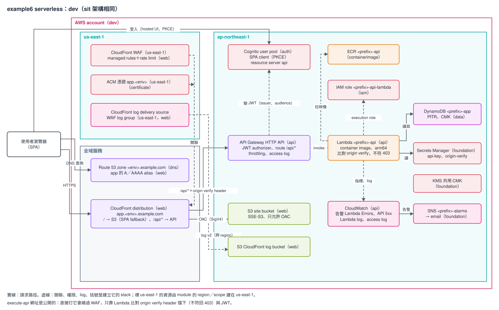

# 範本 example6：serverless（Cognito + HTTP API + Lambda + DynamoDB）

適合前端是 SPA、後端是一組 REST 風格 API、流量不大也不想管 VPC 的專案。使用者用 Cognito 登入，SPA 放在 S3，API 是 API Gateway HTTP API 加 JWT authorizer，後面接一個 container image 的 Lambda 與一張 DynamoDB table。前後端共用一個 CloudFront distribution（`app.<env>.example.com`）和一個 CloudFront WAF：預設路徑走 S3，`/api/*` 走 API Gateway。沒有 VPC，也沒有 NAT。

成本（粗估，未查證）：閒置時每個環境的固定成本主要是 CloudFront WAF，約 10 美元／月起；其餘依用量，低流量時接近 0。見 [REFERENCE〈成本〉](./REFERENCE.md#成本)。



圖是 dev 環境，sit 架構相同。標 us-east-1 的資源由 module 的 `region`／`scope` 建在 us-east-1，stack 不另外宣告 provider。要修改就用 draw.io 打開 `architecture.drawio.svg`，存檔後原圖會一起更新。

規則跟其他範本相同：9 個 Terraform stack，stack 之間只透過 SSM Parameter Store 傳值，stack 只呼叫 registry 的 module，沒有例外。環境只有 `dev`、`sit`。目前只做過離線驗證，還沒在真實帳號 apply 過。

## stack 與 apply 順序

apply 由上往下，destroy 反過來。順序只定義在 `stacks.sh` 的 `ORDER`：

```
containerimage foundation dns certificate auth data iam api web
```

| 順序 | stack | 建什麼 |
|---|---|---|
| 1 | `containerimage` | API Lambda 的 ECR repository |
| 2 | `foundation` | 共用 CMK、告警 SNS topic、兩個 secret 容器（第三方 API key、origin verify 值） |
| 3 | `dns` | 這個環境的子網域 zone（`<env>.example.com`） |
| 4 | `certificate` | CloudFront 用的 `app.<env>.example.com` 憑證（us-east-1） |
| 5 | `auth` | Cognito user pool、SPA client（PKCE，沒有 client secret）、resource server `api` |
| 6 | `data` | DynamoDB table（`PK`、`SK`，on-demand，PITR，CMK） |
| 7 | `iam` | API Lambda 的 execution role |
| 8 | `api` | Lambda、HTTP API（route 都在 `/api/` 底下）、access log、兩個告警 |
| 9 | `web` | SPA bucket、CloudFront、CloudFront WAF（us-east-1）、`app` 的 A／AAAA record、CloudFront log |

每個 stack 讀哪些 key、發布哪些 key，見 REFERENCE〈stack 的內容與依賴〉與〈SSM 合約〉。

## 怎麼部署

`stacks.sh` 把 backend、tfvars、`TF_DATA_DIR` 綁在一起，AWS 身分自己帶。`web` 的 plan、apply 需要 origin verify 的值，不放 tfvars：

```bash
cd infra/terraform
export TF_VAR_origin_verify_header_value=<跟 origin verify secret 相同的值，至少 16 字元>
aws-vault exec <profile> -- ./stacks.sh dev all init             # 第一次、或換環境時先跑：依 envs/dev.tfbackend 設定 backend
aws-vault exec <profile> -- ./stacks.sh dev all plan --dry-run   # 只印出會執行的指令
aws-vault exec <profile> -- ./stacks.sh dev api plan             # 單一 stack
aws-vault exec <profile> -- ./stacks.sh dev all apply            # 依 ORDER，任何一個失敗就停
```

### 第一次 apply

這段是給複製範本、在自己帳號部署的人。這個 repo 不 apply。以 `dev` 為例，指令細節見 [REFERENCE〈第一次 apply〉](./REFERENCE.md#第一次-apply)：

1. 單獨 apply `containerimage`、`foundation`、`dns`。`dns` 輸出 4 個 name server（之後用 `./stacks.sh dev dns output` 再看）。
2. 在上層網域 `example.com` 加一筆 `dev.example.com` 的 NS record，值是那 4 個 name server。用 `dig NS dev.example.com +short` 確認查得到。
3. 產生 origin verify 的值，寫進 `foundation` 的 origin verify secret，再用同一個值 `export TF_VAR_origin_verify_header_value`。Lambda 讀 secret 比對，CloudFront 用環境變數送，兩邊不一致時 API 全部回 403。
4. build API 的映像，推到 `containerimage` 的 repository，tag 要等於 `api` tfvars 的 `api_image_tag`（現在是 `0.1.0`）。映像不在，`api` apply 會失敗。
5. `./stacks.sh dev all apply`。`certificate` 會等到憑證簽發；委派沒做好的話，等滿 45 分鐘會 timeout 失敗，修好委派再跑一次。
6. 把 SPA 的 build 上傳到 `web` 的 site bucket，再對 CloudFront 做 invalidation。bucket 名稱與 distribution ID 在 SSM 的 `web/site_bucket_name`、`web/distribution_id`。

之後的 apply 不用再等憑證：ACM 到期前自動續約。換 API 版本就是推新映像、改 `api_image_tag`、apply `api`。

## 應用程式一定要做的事

Terraform 檢查不到下面這幾件事，漏了就有安全缺口，細節見 [REFERENCE〈應用程式合約〉](./REFERENCE.md#應用程式合約)：

- **Lambda 要比對 origin verify header**：header 名稱在環境變數 `ORIGIN_VERIFY_HEADER_NAME`，值從 `ORIGIN_VERIFY_SECRET_ARN` 的 secret 讀，不符就回 403。execute-api 網址是公開的，沒有這段檢查，直接打它就繞過 WAF。
- route 都在 `/api/` 底下；`GET /api/health` 以外的 route 都要 Cognito access token，JWT 由 API Gateway 驗，繞過 WAF 也繞不過登入。
- 換 origin verify 的值要照 REFERENCE〈runbook：換 origin verify 的值〉的順序，先讓 Lambda 同時接受新舊值。

## 複製出去之後要改什麼

1. module 的 `source`（HCP organization 或 git 來源，見 [`docs/guides/consuming-modules.md`](../../../docs/guides/consuming-modules.md)）。
2. 9 個 stack 的 `common.tf` 的 `accounts_by_env`（`111111111111`、`222222222222`），同步改、保持一字不差。
3. 每份 `envs/*.tfbackend` 的 `bucket`、`kms_key_id`，`key` 的 `example-` 前綴換成自己的 `project`。
4. tfvars 的佔位值：`project`、`expected_account_id`、`dns` 的 `domain_name`、`auth` 的 `domain_prefix`（同一個 region 內唯一）與 `local_dev_origins`、`foundation` 的 `alarm_emails`、`api` 的 `api_image_tag`。完整清單見 REFERENCE〈複製出去之後要改什麼〉。

## 已知限制

細節見 [REFERENCE〈已知限制的細節〉](./REFERENCE.md#已知限制的細節)，第一次 apply 時要逐項確認。

- WAF 只在 CloudFront 前面，HTTP API 本身掛不了 WAF；直接打 execute-api 網址靠 Lambda 的 origin verify 檢查擋。
- Cognito 用 `COGNITO_DEFAULT` 寄信，每個帳號每天 50 封；正式上線前要換 SES。
- Lambda 拉 ECR 映像靠執行 apply 的身分的權限，execution role 沒有 ECR 權限，沒有在真實帳號確認。
- CloudFront log 從 us-east-1 送到 ap-northeast-1 的 bucket，跨 region delivery 沒有在真實帳號確認。
- 告警門檻、IAM 動作清單、KMS key policy 都依文件寫，沒有用真實流量或帳號驗證。

## 驗證

```bash
scripts/validate.sh templates/example6/infra/terraform
```

全部離線，不需要 AWS 憑證，但需要 HCP registry token。其餘內容（SSM 合約、runbook、destroy、驗證表）都在 [REFERENCE.md](./REFERENCE.md)。
