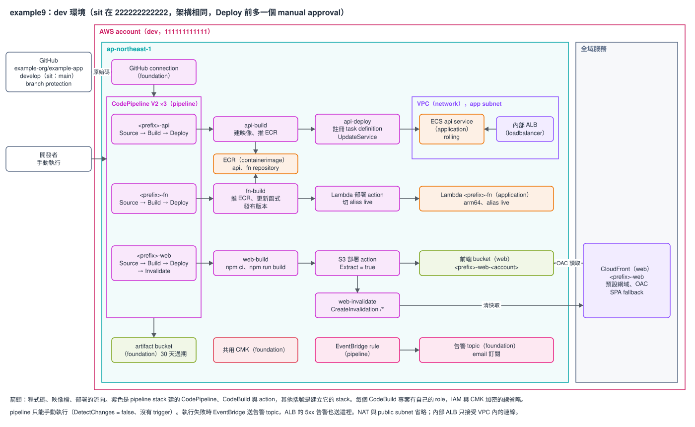

# 範本 example9：CI/CD pipeline（CodePipeline + CodeBuild）

示範公司怎麼用 AWS 原生的 CI/CD 部署應用程式。程式碼放在 GitHub，透過 CodeConnections 連進來；每個環境有三條 CodePipeline V2，各自部署一個元件：ECS Fargate 上的 api（接在內部 ALB 後面）、容器映像檔的 Lambda 函式 fn、S3 加 CloudFront 的前端 web。pipeline 只能手動執行，不會因為 push 自動跑。基礎設施照舊由 Terraform 管，pipeline 只換應用程式的版本：Terraform 用 `bootstrap` 映像建出第一版，之後的版本都由 pipeline 部署。

成本（粗估，未查證）：pipeline 本身每個環境每月不到 5 美元，主要費用是 NAT gateway、內部 ALB 與 api 的 Fargate task。見 [REFERENCE〈成本〉](./REFERENCE.md#成本)。



圖是 dev 環境，sit 架構相同，差別是 sit 在 Deploy 前多一個 manual approval。要修改就用 draw.io 打開 `architecture.drawio.svg`，存檔後原圖會一起更新。

規則跟其他範本相同：8 個 Terraform stack，stack 之間只透過 SSM Parameter Store 傳值，stack 只呼叫 registry 的 module，沒有例外。環境只有 `dev`（`111111111111`）、`sit`（`222222222222`），pipeline 跟部署目標在同一個帳號。目前只做過離線驗證，還沒在真實帳號 apply 過。

## stack 與 apply 順序

apply 由上往下，destroy 反過來。順序只定義在 `stacks.sh` 的 `ORDER`：

```
containerimage foundation network iam loadbalancer application web pipeline
```

| 順序 | stack | 建什麼 |
|---|---|---|
| 1 | `containerimage` | api 與 fn 的 ECR repository |
| 2 | `foundation` | 共用 CMK、pipeline artifact bucket（30 天過期）、告警 SNS topic、GitHub connection |
| 3 | `network` | VPC：public subnet 只放 NAT，app subnet 放 ECS task 與內部 ALB |
| 4 | `iam` | ECS 的 execution 與 task role、Lambda role、5 個建置專案各自的 role、pipeline role |
| 5 | `loadbalancer` | 內部 ALB（HTTP 80，只接受 VPC 內的連線） |
| 6 | `application` | ECS cluster、api service（交給 pipeline 部署、rolling）、fn 函式（alias `live`，交給 pipeline 部署） |
| 7 | `web` | 前端 bucket 與 CloudFront（預設網域、OAC、SPA fallback） |
| 8 | `pipeline` | 5 個 CodeBuild 專案、`api`、`fn`、`web` 三條 pipeline、pipeline 失敗的告警 |

每個 stack 讀哪些 key、發布哪些 key，見 REFERENCE〈stack 的內容與依賴〉與〈SSM 合約〉。

## 怎麼部署

`stacks.sh` 把 backend、tfvars、`TF_DATA_DIR` 綁在一起，AWS 身分自己帶：

```bash
cd infra/terraform
aws-vault exec <profile> -- ./stacks.sh dev all init             # 第一次、或換環境時先跑：依 envs/dev.tfbackend 設定 backend
aws-vault exec <profile> -- ./stacks.sh dev all plan --dry-run   # 只印出會執行的指令
aws-vault exec <profile> -- ./stacks.sh dev pipeline plan        # 單一 stack
aws-vault exec <profile> -- ./stacks.sh dev all apply            # 依 ORDER，任何一個失敗就停
```

### 第一次 apply

這段是給複製範本、在自己帳號部署的人。這個 repo 不 apply。以 `dev` 為例，指令細節見 [REFERENCE〈第一次 apply〉](./REFERENCE.md#第一次-apply)：

1. 單獨 apply `containerimage`、`foundation`。
2. 到 console 授權 GitHub connection。connection 建好時是 `PENDING`，沒授權的話 pipeline 的 Source stage 會失敗。步驟見 [REFERENCE〈GitHub connection 的授權〉](./REFERENCE.md#github-connection-的授權)。
3. 手動 build api 與 fn 的映像檔（arm64），tag 用 `bootstrap` 推到兩個 repository。映像檔不在的話，`application` apply 時建不出 Lambda，ECS 也一直拉不到映像檔。
4. `./stacks.sh dev all apply`。
5. 在應用程式 repo 放好 5 份 buildspec（範例見 REFERENCE〈範例 buildspec〉），並替部署的分支開 branch protection。
6. 依序手動執行 `cicd-dev-api`、`cicd-dev-fn`、`cicd-dev-web` 三條 pipeline。前端 bucket 在 web pipeline 跑完之前是空的。

## 上線前一定要做的事

Terraform 檢查不到下面這幾件事，漏了就有安全缺口或部署不到，細節見 REFERENCE：

- **部署的分支只能透過 PR 合併。** 建置專案執行的是 repo 裡的 buildspec，能 push 到這個分支的人就能用建置 role 的權限做事（〈branch protection〉）。
- 誰能執行 pipeline、誰能核准 sit 的部署，由 IAM 決定，範本不建這些權限；需要的 action 見〈執行 pipeline〉。
- api 的 CPU、記憶體、container 設定，fn 的記憶體、逾時這類設定，在 Terraform 改完之後要再跑一次對應的 pipeline 才會生效（〈Terraform 的設定變動什麼時候生效〉）。

## 複製出去之後要改什麼

1. module 的 `source`（HCP organization 或 git 來源，見 [`docs/guides/consuming-modules.md`](../../../docs/guides/consuming-modules.md)）。
2. 8 個 stack 的 `common.tf` 的 `accounts_by_env`（`111111111111`、`222222222222`），同步改、保持一字不差。
3. 每份 `envs/*.tfbackend` 的 `bucket`、`kms_key_id`，`key` 的 `cicd-` 前綴換成自己的 `project`。
4. tfvars 的佔位值：`project`、`expected_account_id`、`foundation` 的 `alarm_emails`、`pipeline` 的 `repository` 與 `branch`。完整清單見 REFERENCE〈複製出去之後要改什麼〉。

## 已知限制

細節見 [REFERENCE〈已知限制的細節〉](./REFERENCE.md#已知限制的細節)，第一次 apply 時要逐項確認。

- GitHub connection 要有人在 console 授權一次，Terraform 做不到。
- Terraform 的 state 跟實際執行的版本不同：api service 用的 task definition、fn alias 指的版本都由 pipeline 決定，`terraform plan` 不會顯示這個差異。
- 範本的 api 用 rolling 部署。改成 ECS 原生 blue/green 的做法見 REFERENCE〈改用 blue/green〉，沒有在真實環境驗證。
- Lambda 部署 action 不帶 input artifact、CodeBuild action 覆寫 `IMAGE_URI`、IAM 動作清單都依 AWS 文件寫，沒有在真實帳號確認。

## 驗證

```bash
scripts/validate.sh templates/example9/infra/terraform
```

全部離線，不需要 AWS 憑證，但需要 HCP registry token。其餘內容（SSM 合約、buildspec、IAM、blue/green、destroy、驗證表）都在 [REFERENCE.md](./REFERENCE.md)。
