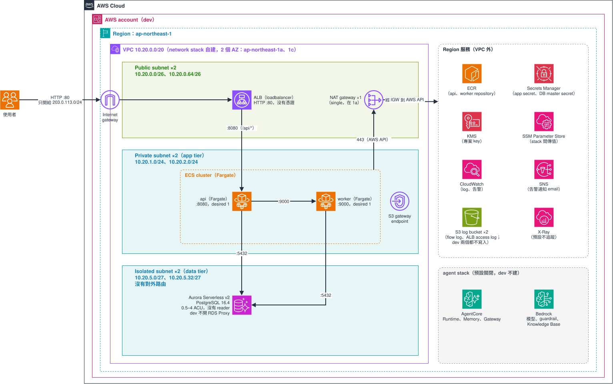

# 專案 infra 範本

適合一般的三層專案：ALB 在 public subnet，ECS（Fargate）服務在 private subnet，資料庫在 isolated subnet，需要時再開 AgentCore 與 Bedrock。整套拆成 9 個 Terraform stack，stack 只呼叫 `modules/` 底下的共用 module，彼此只透過 SSM Parameter Store 傳值。



圖是 `envs/dev.tfvars` 的樣子。prod 的結構相同，規格不同：VPC `10.30.0.0/19`、每個 AZ 一個 NAT、5 個 interface endpoint（`ecr.api`、`ecr.dkr`、`logs`、`secretsmanager`、`kms`）、flow log 開、ALB 走 HTTPS 並開 access log、RDS Proxy 開、Aurora 2 到 16 ACU 加 1 個 reader、刪除保護開、服務各 2 個 task 並自動擴縮。用 draw.io 打開 `architecture.drawio.svg` 就能編輯。

## apply 順序

apply 照下表，destroy 反過來。順序寫在 `terraform/stacks.sh` 的 `ORDER`（單行），改順序就改那一行。

| 順序 | stack | 建什麼 |
|---|---|---|
| 1 | `foundation` | KMS key、告警 SNS、兩個 log bucket、secret 容器（範本裡唯一自己宣告的 AWS resource） |
| 2 | `containerimage` | ECR；服務清單與 Runtime 清單的單一決定點 |
| 3 | `network` | VPC（或登記既有 VPC）、interface endpoint、所有 security group |
| 4 | `iam-base` | ECS execution role、RDS Proxy role（只有 trust）、Enhanced Monitoring role、Runtime execution role、KB 與 Gateway role（只有 trust） |
| 5 | `data` | 資料庫（可選 Proxy、可選 Data API） |
| 6 | `agent` | AgentCore Runtime、Memory、Gateway，Bedrock guardrail、inference profile、Knowledge Base 與語料 bucket；預設關閉 |
| 7 | `iam-app` | Proxy 讀 secret 的 policy、各服務 task role、ECS Exec 開關、追蹤開關、AgentCore 與 Bedrock 的權限 |
| 8 | `loadbalancer` | ALB、listener |
| 9 | `application` | ECS cluster、service、autoscaling、服務告警、log 告警、X-Ray 抽樣、ADOT collector sidecar |

`agent` 什麼都沒開也一定要在 `iam-app` 之前 apply。每個 stack 讀哪些上游、升級與 destroy 的注意事項見 [REFERENCE.md](./REFERENCE.md)〈apply 順序的讀取來源〉。

## 部署

`terraform/stacks.sh` 依 env 一起選好 backend、tfvars 與 `TF_DATA_DIR`，可以跑單一 stack，或依 `ORDER` 跑全部（destroy 反向）。AWS 身分自己帶：

```bash
aws-vault exec <profile> -- infra/terraform/stacks.sh dev application init
aws-vault exec <profile> -- infra/terraform/stacks.sh dev application plan
aws-vault exec <profile> -- infra/terraform/stacks.sh dev all plan --dry-run   # 只印出會執行的指令
infra/terraform/stacks.sh dev all destroy --dry-run                           # 看 destroy 的順序
```

`--yes` 讓 apply、destroy 不再詢問；`--` 之後的參數原樣交給 terraform（例如 `-- -target=...`）。手打 `terraform` 時，AWS 身分、backend、變數、工作目錄四個選擇要自己對齊：

```bash
cd infra/terraform/application
export TF_DATA_DIR=.terraform-dev
terraform init -reconfigure -backend-config=envs/dev.tfbackend
terraform plan -var-file=envs/dev.tfvars
```

換環境一律 `init -reconfigure`，不要用 `-migrate-state`（它會把 state 搬過去）。

## 複製出去之後要改什麼

1. module 的 `source`：範本從 HCP private registry 引用（`app.terraform.io/libterty/<module>/aws` 加 `version`，ADR-0004）。用 `libterty` 這個 organization 就不用改，`terraform login` 後跑 `terraform init -backend=false` 確認抓得到。用自己的 organization 時換掉 `app.terraform.io/libterty/`；拿不到 HCP token 時改成 `git::...?ref=<module>-v<semver>`。兩種改法的指令見 `docs/guides/consuming-modules.md`。
2. 改 `common.tf` 的 `accounts_by_env`，填入各環境的帳號；9 個 stack 同步改，保持一字不差。
3. 改每份 `envs/*.tfbackend` 的 `bucket`（目前是 `<state-bucket>` 佔位符）與 key 的 `alpha` 前綴。
4. 改每份 `envs/*.tfvars` 的 `project`、`expected_account_id`，以及各 stack 的佔位值：告警 email、`image_tag`、ACM 憑證 ARN、`alb_ingress` 的來源 CIDR 或 prefix list。
5. tfvars 不放 secret。應用程式的 secret 值寫進 `foundation` 建好的 secret 容器，Terraform 只引用 ARN。

要換規格時，從 `envs/examples/{poc,standard,high}.tfvars` 挑一份複製成 `envs/<env>.tfvars` 再改。

## 已知限制

- 整套只用 mock provider 測過，沒有在真實帳號 `plan` 或 `apply`。RDS Proxy 與 Knowledge Base 第一次部署的行為沒有實測，各排成兩段式步驟。
- 應用程式直接用資料庫的 master secret，之後要補應用程式專用帳號，或改用 Proxy 的 IAM 認證。
- 範本沒有建 WAF Web ACL（只能關聯既有的），也沒有 Redis、部署 workflow、state bucket 本身。
- 大流量規格與各抽樣比例沒有實測依據。

完整的 SSM 合約、單一決定點、依流量調整規格、客戶自管資源、X-Ray 追蹤、第一次部署的 runbook 與未驗證清單，見 [REFERENCE.md](./REFERENCE.md)。
